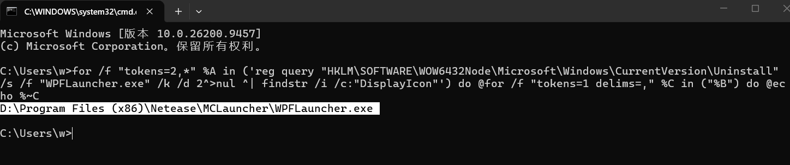
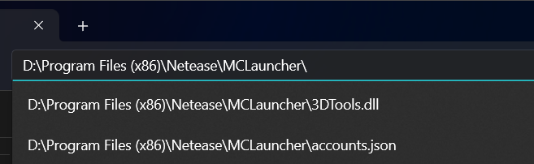
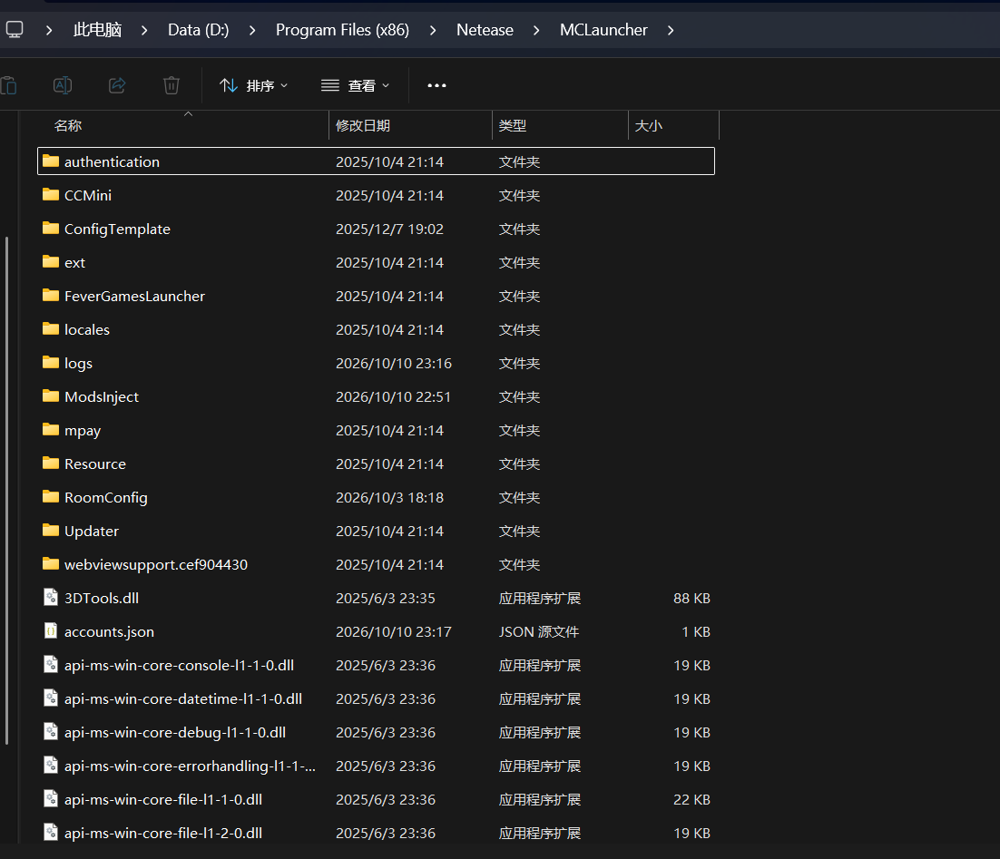
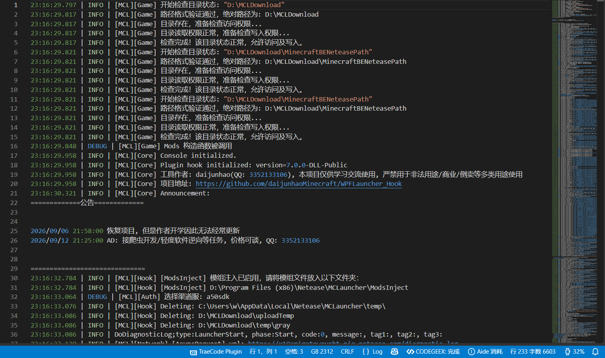
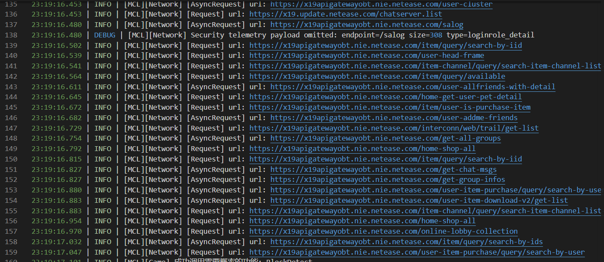
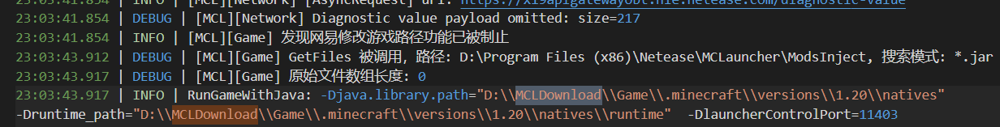
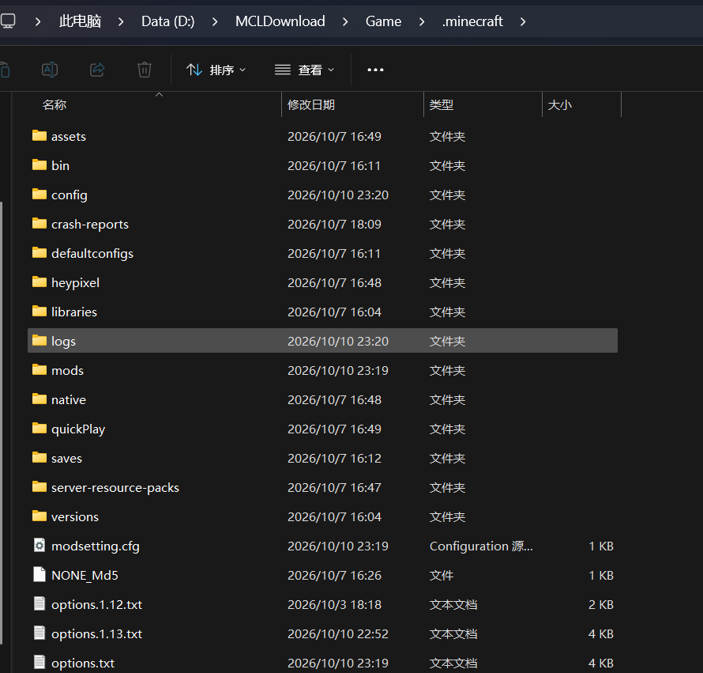
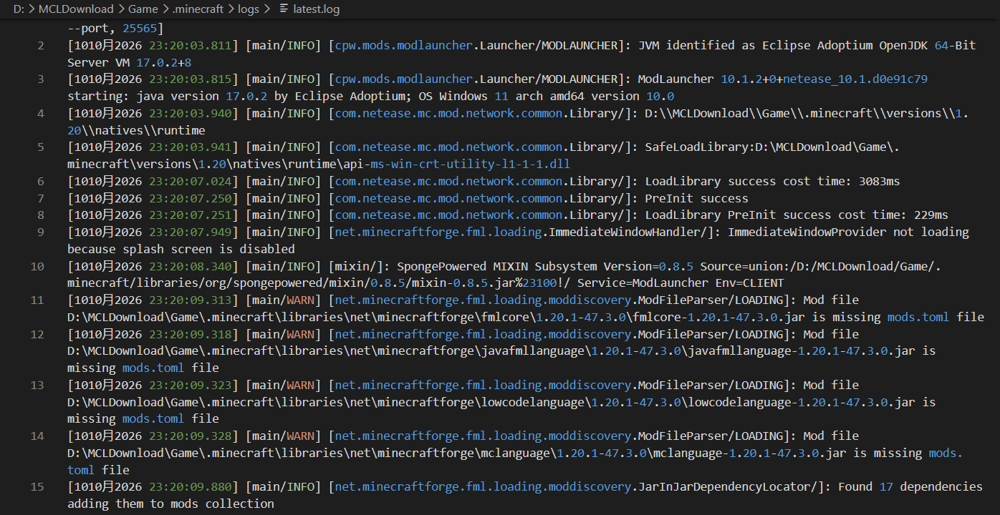

## 1.找到启动器目录

请见"如何安装并使用WPFLauncher_Hook"的1.2安装部分。  
一般启动器目录位于这类位置：  
"D:\Program Files (x86)\Netease\MCLauncher"  
"D:\Program Files\Netease\MCLauncher"  
"C:\Program Files (x86)\Netease\MCLauncher"  
也有可能是安装时设置的自定义目录，可以通过"找到进程所在位置"这篇文章的方法来确定。

或者你也可以通过注册表来确定：  
使用以下命令：  
`for /f "tokens=2,*" %A in ('reg query "HKLM\SOFTWARE\WOW6432Node\Microsoft\Windows\CurrentVersion\Uninstall" /s /f "WPFLauncher.exe" /k /d 2^>nul ^| findstr /i /c:"DisplayIcon"') do @for /f "tokens=1 delims=," %C in ("%B") do @echo %~C`  
先使用Win+R打开运行窗口，然后输入`cmd`，再输入上述命令，回车，即可得到启动器目录。  
如图：  
  
原理：在HKLM\SOFTWARE\WOW6432Node\Microsoft\Windows\CurrentVersion\Uninstall中遍历所有子项，找到包含"WPFLauncher.exe"的项，然后获取DisplayIcon值，即可得到启动器目录。上面那条命令的for/f用于兼容有些电脑会出现",0"的情况，如果只需要输出完整值的话`reg query "HKLM\SOFTWARE\WOW6432Node\Microsoft\Windows\CurrentVersion\Uninstall" /s /f "WPFLauncher.exe" /k /d 2>nul | findstr /i /c:"DisplayIcon"`就可以。

## 2.启动器目录结构

将上方得到的目录输入文件资源管理器中（不要连带WPFLauncher.exe，不然会直接打开启动器而不是文件夹目录），展示如图：  
  
  
这是整个目录的全貌。

## 2.1 各个目录解析

tree结果，以下为文件结构树：  
`  
PS D:\Program Files (x86)\Netease\MCLauncher> tree  
D:.  
├─authentication  
│  ├─gray_x64  
│  ├─x64  
│  └─x86  
├─CCMini  
├─ConfigTemplate  
├─ext  
│  ├─7z  
│  └─opengl  
├─FeverGamesLauncher  
├─locales  
├─logs  
├─mpay  
│  └─skin  
├─Resource  
│  ├─font  
│  ├─gifFolder  
│  │  └─dailySignBg  
│  ├─Music  
│  ├─Res  
│  ├─video  
│  ├─waiting  
│  └─WordMask  
├─RoomConfig  
├─Updater  
└─webviewsupport.cef904430  
    └─locales  
`

authentication目录：授权/保护SDK存放目录。  
CCMini目录：疑似语音目录，可能是用于游戏内语音通话的。  
ConfigTemplate目录：配置模板目录。空目录。  
ext目录：自带7zip与获取OpenGL版本的程序。7zip用于解压下载下来的游戏组件包/游戏本体，opengl/getVersion获取OpenGL图形库版本。  
FeverGamesLauncher目录：网易“发烧游戏”平台组件。  
locales目录：CEF 浏览器内核的多语言包（一堆.pak文件）。  
**logs目录：启动器日志目录。**  
mpay目录：存储支付组件皮肤（skin_x19.zip），有网易支付SDK。  
Resource目录：存储游戏资源。  
RoomConfig：里面有联机房间配置。有BlackList.json 和 RegexBlackList.json黑名单。  
Updater目录：更新器目录。  
webviewsupport.cef904430目录：浏览器内核目录。

## 2.2 logs日志解析

以安装了WPFLauncher_Hook的启动器为例，启动器日志形态：

  
其中这种日志可以忽略：  
  
特征为[MCL][Network]开头。

其余的可以自己翻译一下，或者直接交给AI。基本上启动不起来的问题都会写到里面。

## 2.2.1 游戏日志解析

在2.2所述日志中搜索MCLDownload（需要至少启动过一次游戏），即可获得网易游戏目录，如图：  
  
图中给出的是D:\\MCLDownload\\Game\\.minecraft\\versions\\1.20\\natives，只需要取到.minecraft即可。如：  
`D:\MCLDownload\Game\.minecraft\`  
同理进入此目录，可看到这就是游戏本体所在目录：  
  
进入logs目录，即可获得游戏日志。如图：  

接下来你就能靠这两个log日志自己解决绝大多数的问题了。
